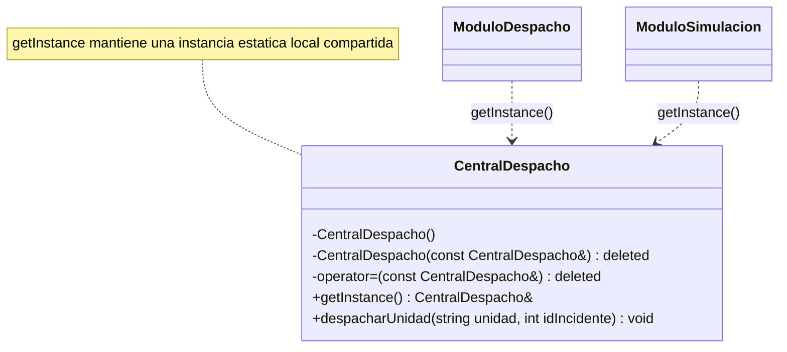
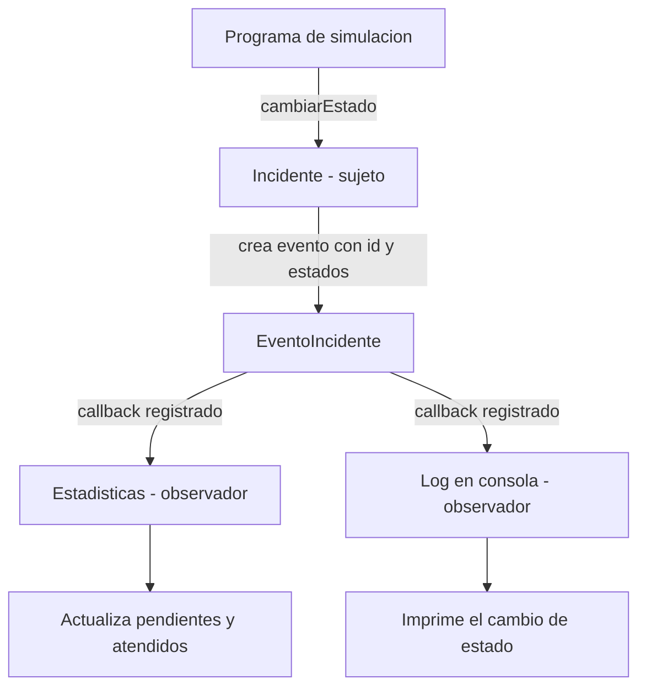

# Avance 5 Patrones GoF aplicados a SIDEA

## Propósito

En SIDEA, Sistema Inteligente de Despacho de Emergencias de Arequipa, aplicamos dos patrones GoF: Singleton para controlar el acceso a una central de despacho compartida y Observer para comunicar los cambios de estado de los incidentes. Ambos permiten organizar responsabilidades: la central representa el punto común de coordinación y cada observador responde a los eventos según su función.

## Singleton en CentralDespacho

### Problema de diseño

Sin este patrón, un constructor público permite que cada módulo cree su propia CentralDespacho. Si cada central administra sus propios registros, las unidades y los incidentes podrían quedar repartidos en objetos distintos. La simulación necesita una central compartida para que sus componentes utilicen el mismo punto de coordinación.

### Solución aplicada

CentralDespacho tiene un constructor privado y elimina el constructor de copia y el operador de asignación. El método estático getInstance() devuelve una referencia a un objeto estático local, creado al solicitarlo por primera vez. Las llamadas posteriores devuelven esa misma instancia. Así se controla la creación sin solicitar memoria manualmente con new.

### Diagrama simple de Singleton



Los módulos representan posibles clientes. Ambos obtienen la misma central mediante getInstance(); no crean centrales independientes.

### Código de Singleton

Archivo CentralDespacho.h, existente en el repositorio:

```cpp
#pragma once
#include <iostream>
#include <string>

class CentralDespacho {
private:
    // Constructor privado (Singleton)
    CentralDespacho() {
        std::cout << "Iniciando la UNICA Central de Despacho del sistema...\n";
    }
    
    CentralDespacho(const CentralDespacho&) = delete;
    CentralDespacho& operator=(const CentralDespacho&) = delete;

public:
    static CentralDespacho& getInstance() {
        static CentralDespacho instancia;
        return instancia;
    }

    void despacharUnidad(std::string unidad, int idIncidente) {
        std::cout << "Despachando " << unidad << " al incidente " << idIncidente << std::endl;
    }
};

```

### Justificación de la mejora

Frente a la creación libre de centrales, Singleton impide la instanciación directa externa y la duplicación mediante copia. En una simulación con una única central, esto evita crear coordinadores separados por error y ofrece una forma común de acceso desde diferentes módulos.

La unicidad no reemplaza la lógica de negocio: el código actual de despacharUnidad muestra un mensaje, pero todavía no almacena unidades, comprueba disponibilidad ni administra colas de incidentes. Esas responsabilidades deben incorporarse a la central para completar el sistema. Además, compartir una instancia introduce una dependencia global y requiere cuidado al realizar pruebas con simulaciones independientes. Si se trabaja con varios hilos, el acceso a sus datos también necesitará sincronización.

## Observer en los cambios de estado de Incidente

### Problema de diseño

Durante la simulación, un incidente recorre los estados PENDIENTE, ASIGNADO, EN_ATENCION y ATENDIDO. Diferentes módulos necesitan conocer estos cambios. Si Incidente llamara directamente a Estadisticas, a una clase de registro y a la interfaz, dependería de todos ellos. Agregar un nuevo receptor obligaría a modificar el incidente.

### Solución aplicada

Incidente actúa como sujeto y almacena callbacks de tipo std::function<void(const EventoIncidente&)>. El evento contiene el identificador del incidente y sus estados anterior y actual. Al realizar una transición válida, el sujeto actualiza su estado y ejecuta los callbacks registrados.

Estadisticas actúa como observador mediante una lambda que llama a actualizar(). Un segundo callback escribe el historial en consola. Esta implementación manual no requiere Qt ni una interfaz IObserver; los callbacks proporcionan el contrato común para los receptores.

El flujo permitido es PENDIENTE → ASIGNADO → EN_ATENCION → ATENDIDO. Repetir el estado actual no produce una notificación y los saltos o retrocesos se rechazan. En este ejemplo, el contador pendientes representa todos los incidentes aún no finalizados, incluidos los asignados y los que están en atención.

### Diagrama simple de Observer



Las flechas representan el flujo de la notificación. Incidente conserva callbacks; no mantiene dependencias directas hacia Estadisticas ni hacia un tipo concreto de registro. El programa cliente conecta a los participantes.

### Código de Observer

Archivo EventoIncidente.h:

```cpp
#pragma once

enum class EstadoIncidente { PENDIENTE, ASIGNADO, EN_ATENCION, ATENDIDO };
enum class TipoIncidente { INCENDIO, ACCIDENTE, ROBO, URGENCIA_MEDICA };
enum class PrioridadIncidente { BAJA, MEDIA, ALTA, CRITICA };

struct EventoIncidente {
    int idIncidente;
    EstadoIncidente estadoAnterior;
    EstadoIncidente estadoActual;
};

```

Archivo Incidente.h:

```cpp
#pragma once
#include "EventoIncidente.h"
#include <functional>
#include <stdexcept>
#include <utility>
#include <vector>

class Incidente {
public:
    using Observador = std::function<void(const EventoIncidente&)>;

    explicit Incidente(int id) : id(id) {}

    int getId() const { return id; }
    EstadoIncidente getEstado() const { return estado; }

    void agregarObservador(Observador observador) {
        if (!observador) {
            throw std::invalid_argument("El observador no puede estar vacio");
        }
        observadores.push_back(std::move(observador));
    }

    void cambiarEstado(EstadoIncidente nuevoEstado) {
        if (nuevoEstado == estado) return;
        if (static_cast<int>(nuevoEstado) != static_cast<int>(estado) + 1) {
            throw std::invalid_argument("Transicion de estado no permitida");
        }
        const EventoIncidente evento{id, estado, nuevoEstado};
        estado = nuevoEstado;
        // La copia permite registrar observadores durante una notificacion.
        // Estos recibiran los eventos siguientes, no el evento en curso.
        const auto receptores = observadores;
        for (const auto& observador : receptores) observador(evento);
    }

private:
    int id;
    EstadoIncidente estado = EstadoIncidente::PENDIENTE;
    std::vector<Observador> observadores;
};

```

Archivo Estadisticas.h:

```cpp
#pragma once
#include "EventoIncidente.h"

class Estadisticas {
public:
    // Llamar una vez por incidente, al registrarlo en estado PENDIENTE.
    void registrarIncidente() { ++pendientes; }

    void actualizar(const EventoIncidente& evento) {
        if (evento.estadoActual == EstadoIncidente::ATENDIDO &&
            evento.estadoAnterior != EstadoIncidente::ATENDIDO) {
            ++atendidos;
            if (pendientes > 0) --pendientes;
        }
    }

    int getPendientes() const { return pendientes; }
    int getAtendidos() const { return atendidos; }

private:
    // Pendientes significa incidentes aun no finalizados, incluidos los asignados.
    int pendientes = 0;
    int atendidos = 0;
};

```

### Justificación de la mejora

Frente a las llamadas directas a cada módulo, Observer permite que Incidente se concentre en sus datos y transiciones. Cada receptor decide cómo procesar la información: Estadisticas actualiza los contadores y el log muestra el historial. Si se necesita un resumen o un módulo adicional, el cliente puede registrar otro callback sin modificar cambiarEstado().

La actualización se produce cuando ocurre el cambio, sin consultar repetidamente el estado del incidente. Esto reduce el acoplamiento y facilita ampliar los receptores del evento. El ejemplo usa notificaciones síncronas y supone que los callbacks no lanzan excepciones. Los observadores capturados por referencia deben permanecer vivos mientras puedan recibir avisos. Para una aplicación de mayor duración convendría añadir un mecanismo de desconexión.

## Demostración conjunta de ambos patrones

El siguiente programa obtiene dos referencias a CentralDespacho para comprobar su identidad, crea un incidente y conecta dos observadores. Después simula su atención y verifica que las estadísticas y los avisos sean coherentes. El envío de una unidad se representa mediante el mensaje de la central; la secuencia de estados la dirige el programa de demostración.

Archivo demo_sidea.cpp:

```cpp
#include "CentralDespacho.h"
#include "Incidente.h"
#include "Estadisticas.h"
#include <iostream>

const char* nombreEstado(EstadoIncidente estado) {
    switch (estado) {
        case EstadoIncidente::PENDIENTE: return "PENDIENTE";
        case EstadoIncidente::ASIGNADO: return "ASIGNADO";
        case EstadoIncidente::EN_ATENCION: return "EN_ATENCION";
        case EstadoIncidente::ATENDIDO: return "ATENDIDO";
    }
    return "DESCONOCIDO";
}

int main() {
    auto& central = CentralDespacho::getInstance();
    auto& mismaCentral = CentralDespacho::getInstance();
    std::cout << "Misma central: "
              << (&central == &mismaCentral ? "SI" : "NO") << '\n';

    Estadisticas estadisticas;
    int notificacionesLog = 0;
    Incidente incidente(101);
    estadisticas.registrarIncidente();

    incidente.agregarObservador([&estadisticas](const EventoIncidente& evento) {
        estadisticas.actualizar(evento);
    });
    incidente.agregarObservador([&notificacionesLog](const EventoIncidente& evento) {
        ++notificacionesLog;
        std::cout << "[LOG] Incidente " << evento.idIncidente << ": "
                  << nombreEstado(evento.estadoAnterior) << " -> "
                  << nombreEstado(evento.estadoActual) << '\n';
    });

    central.despacharUnidad("Ambulancia A-01", incidente.getId());
    incidente.cambiarEstado(EstadoIncidente::ASIGNADO);
    incidente.cambiarEstado(EstadoIncidente::EN_ATENCION);
    incidente.cambiarEstado(EstadoIncidente::ATENDIDO);
    incidente.cambiarEstado(EstadoIncidente::ATENDIDO); // No duplica el evento.

    bool retrocesoRechazado = false;
    try {
        incidente.cambiarEstado(EstadoIncidente::PENDIENTE);
    } catch (const std::invalid_argument&) {
        retrocesoRechazado = true;
    }

    std::cout << "Pendientes: " << estadisticas.getPendientes() << '\n'
              << "Atendidos: " << estadisticas.getAtendidos() << '\n'
              << "Notificaciones de log: " << notificacionesLog << '\n'
              << "Retroceso rechazado: " << (retrocesoRechazado ? "SI" : "NO") << '\n';

    return (&central == &mismaCentral && estadisticas.getPendientes() == 0 &&
            estadisticas.getAtendidos() == 1 && notificacionesLog == 3 &&
            retrocesoRechazado) ? 0 : 1;
}

```

### Compilación y ejecución

Desde la carpeta Lab08_TO, en PowerShell:

```powershell
g++ -std=c++14 -Wall -Wextra -pedantic demo_sidea.cpp -o demo_sidea.exe
.\demo_sidea.exe
```

El ejemplo usa características disponibles en C++14 y también puede compilarse con C++17 en un compilador compatible. Se comprobó con GCC 6.3.0 y C++14. Se compila demo_sidea.cpp por separado de main.cpp porque cada uno define su propia función main.

### Salida verificada

```text
Iniciando la UNICA Central de Despacho del sistema...
Misma central: SI
Despachando Ambulancia A-01 al incidente 101
[LOG] Incidente 101: PENDIENTE -> ASIGNADO
[LOG] Incidente 101: ASIGNADO -> EN_ATENCION
[LOG] Incidente 101: EN_ATENCION -> ATENDIDO
Pendientes: 0
Atendidos: 1
Notificaciones de log: 3
Retroceso rechazado: SI
```

La central se inicializa una vez y las dos referencias apuntan al mismo objeto. Los tres cambios válidos generan tres mensajes de log. El segundo intento de establecer ATENDIDO no incrementa los contadores ni produce otro aviso. El intento de regresar a PENDIENTE se rechaza. El programa termina con código 0 cuando se cumplen estas comprobaciones.

## Correspondencia con el informe

El Singleton se conserva en CentralDespacho.h. EventoIncidente.h define el mensaje compartido por los participantes. La relación Observer se completa con Incidente.h y Estadisticas.h y se muestra en demo_sidea.cpp. El ejemplo de personas de main.cpp se mantiene como ejercicio del docente.

Para que el Avance 4 describa esta implementación, las referencias a IObserver.h, IObservable.cpp, Incidente.cpp y Estadisticas.cpp deben sustituirse por los archivos anteriores. La descripción correspondiente es: «Implementamos Observer mediante callbacks. Incidente permite registrar funciones que reciben un EventoIncidente. Cuando ocurre una transición válida, notifica a los callbacks de Estadisticas y del log. Estadisticas actualiza los contadores al finalizar la atención y el log muestra cada cambio».

## Conclusión

Singleton controla la creación y el acceso a la central compartida de SIDEA. Observer distribuye los cambios de estado de los incidentes sin incorporar la lógica de cada receptor en el sujeto. La demostración comprueba ambos mecanismos y respalda el diseño propuesto para la simulación.
